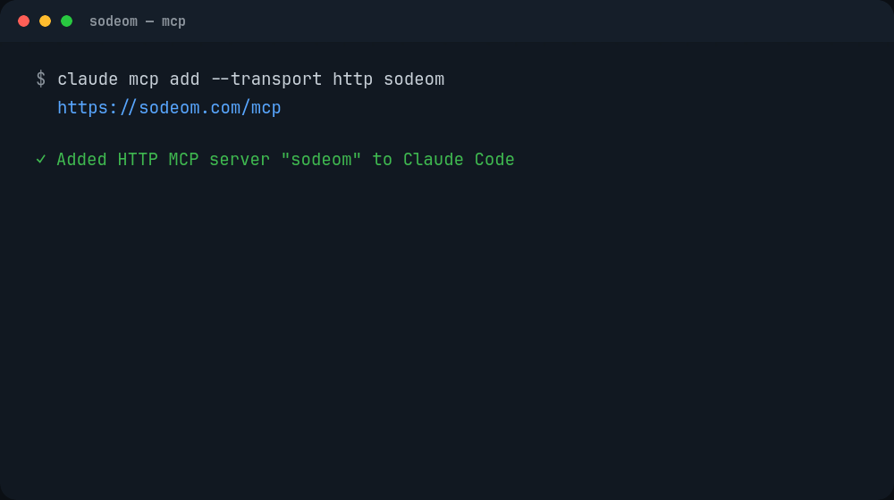
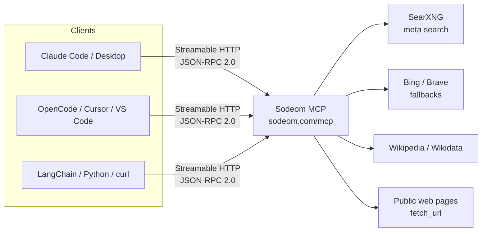
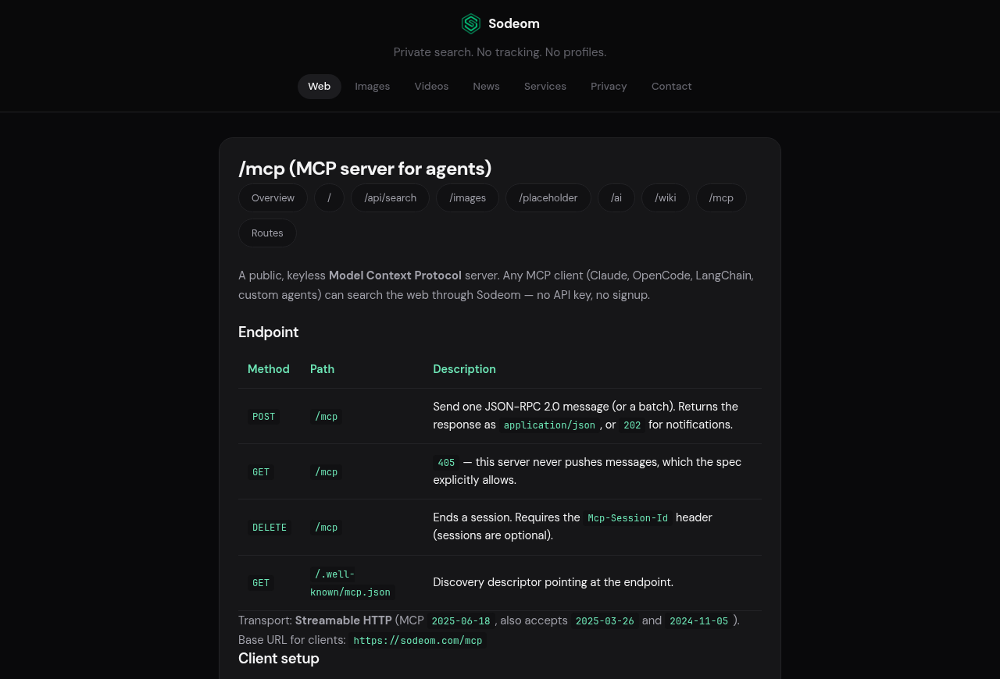
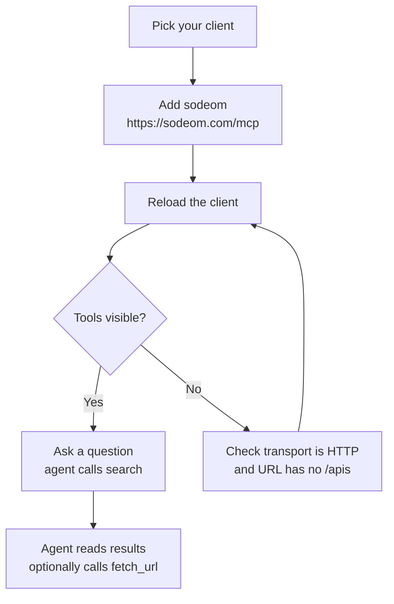
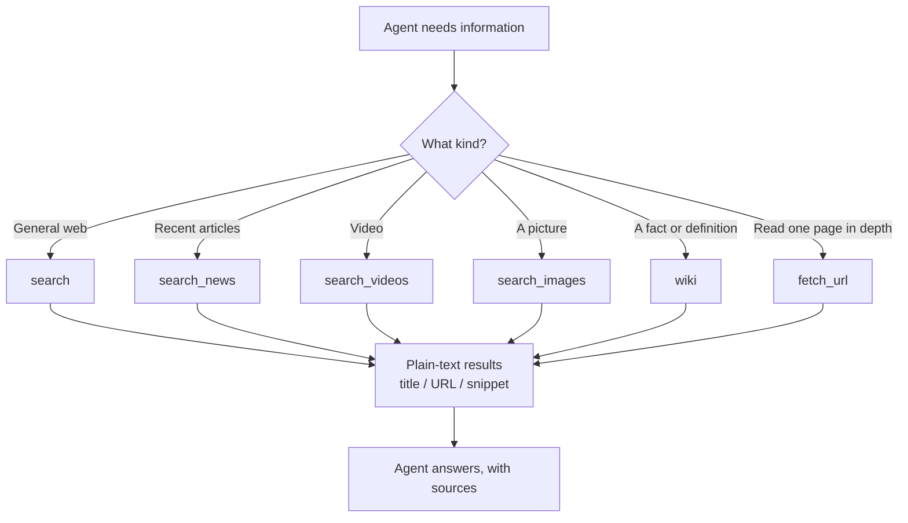
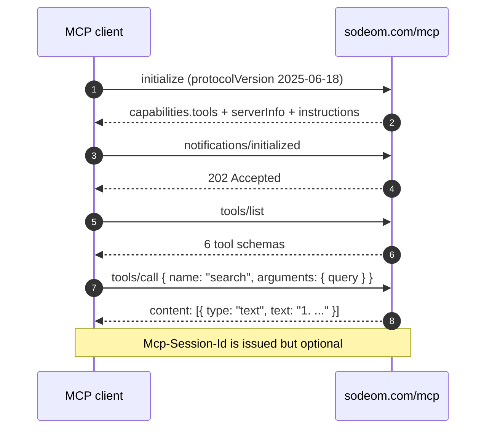
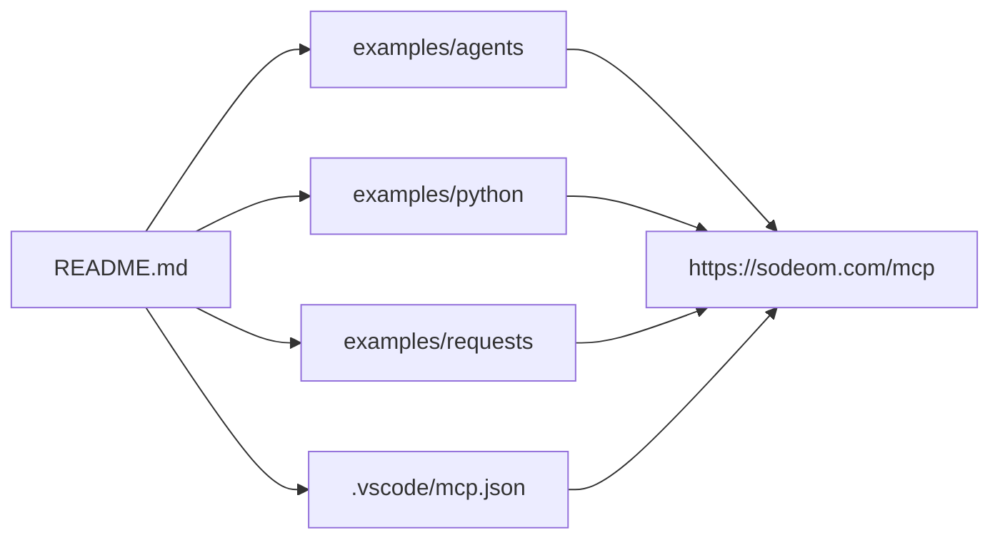

<h1 align="center">Sodeom MCP</h1>

<p align="center">
  A public, keyless <strong>Model Context Protocol</strong> server.<br/>
  Point any MCP client at <code>https://sodeom.com/mcp</code> and your agent can search the web.
</p>

<p align="center">
  <a href="https://modelcontextprotocol.io"></a>
  <a href="#endpoint"></a>
  <a href="#why-sodeom"></a>
  <a href="LICENSE"></a>
</p>

---

**Sodeom MCP** gives AI agents private web search without an API key, an account, or a
billing setup. It speaks the standard MCP **Streamable HTTP** transport, so it works with
Claude Code, Claude Desktop, OpenCode, Cursor, VS Code, LangChain, the Python SDK, or any
custom agent.

This repository is the integration guide and a set of copy-paste configs. The server itself
is hosted — there is nothing to install or run.

## Why Sodeom

| Feature | Detail |
| --- | --- |
| 🔑 **Keyless** | No API key, token, signup or credit card. The endpoint is public. |
| 🕵️ **Private** | No tracking, no profiles, no query logging beyond transient caching. |
| 🔒 **Read-only** | All six tools are marked `readOnlyHint`, so agents cannot change anything. |
| 🧠 **Agent-shaped** | Plain-text results capped at 12 000 characters to keep context small. |
| 🌍 **Six tools** | Web, news, videos, images, Wikipedia/Wikidata, and page reading. |
| ⚡ **Stateless-friendly** | `Mcp-Session-Id` is optional, so one-shot JSON-RPC calls work too. |

## How it works



The server is a thin, read-only bridge: MCP in, search results out. Nothing is stored about
the caller, and `fetch_url` refuses private, loopback and link-local addresses.

## Endpoint

**Base URL for clients:** `https://sodeom.com/mcp`

| Method | Path | Behavior |
| --- | --- | --- |
| `POST` | `/mcp` | Send one JSON-RPC 2.0 message (or a batch). Returns `application/json`, or `202` for notifications. |
| `GET` | `/mcp` | `405` — this server never pushes messages (allowed by the spec). |
| `DELETE` | `/mcp` | Ends a session. Sends `Mcp-Session-Id` when one was issued. |
| `GET` | `/.well-known/mcp.json` | Discovery descriptor pointing at the endpoint. |

- **Transport:** Streamable HTTP
- **Protocol:** MCP `2025-06-18` (also accepts `2025-03-26` and `2024-11-05`)
- **Auth:** none

> ⚠️ `https://sodeom.com/apis/mcp` is the human-readable documentation page, not the MCP
> endpoint. Clients must use `https://sodeom.com/mcp`.

[](https://sodeom.com/apis/mcp)

## Quick start

1. Copy the snippet for your client below (or grab a file from [`examples/agents`](examples/agents)).
2. Paste it into the client's MCP config.
3. Restart or reload the client.
4. Ask the agent something that needs the web — for example *“search for the Python 3.14 release notes”*.



### Claude Code

```bash
claude mcp add --transport http sodeom https://sodeom.com/mcp
```

Verify with `claude mcp list`, then use `/mcp` inside a session.

### Claude Desktop

Claude Desktop speaks stdio, so bridge to the remote endpoint with
[`mcp-remote`](https://www.npmjs.com/package/mcp-remote) (Node.js required). Edit
**Settings → Developer → Edit Config** and add:

```json
{
  "mcpServers": {
    "sodeom": {
      "command": "npx",
      "args": ["-y", "mcp-remote", "https://sodeom.com/mcp"]
    }
  }
}
```

See [`examples/agents/claude_desktop.json`](examples/agents/claude_desktop.json).

### OpenCode

Add to `opencode.json` (project) or `~/.config/opencode/opencode.json` (global):

```json
{
  "$schema": "https://opencode.ai/config.json",
  "mcp": {
    "servers": {
      "sodeom": {
        "type": "remote",
        "url": "https://sodeom.com/mcp"
      }
    }
  }
}
```

See [`examples/agents/opencode.json`](examples/agents/opencode.json).

### Cursor

Add to `.cursor/mcp.json` (project) or `~/.cursor/mcp.json` (global):

```json
{
  "mcpServers": {
    "sodeom": {
      "url": "https://sodeom.com/mcp"
    }
  }
}
```

See [`examples/agents/cursor_mcp.json`](examples/agents/cursor_mcp.json).

### VS Code (GitHub Copilot)

This repo ships [`.vscode/mcp.json`](.vscode/mcp.json), so the server is picked up when you
open the folder. To add it elsewhere:

```json
{
  "servers": {
    "sodeom": {
      "type": "http",
      "url": "https://sodeom.com/mcp"
    }
  }
}
```

Then run **MCP: List Servers** from the Command Palette.

### Python (`mcp` SDK)

```python
import asyncio
from mcp import ClientSession
from mcp.client.streamable_http import streamable_http_client   # mcp >= 2

async def main():
    # mcp 1.x: from mcp.client.streamable_http import streamablehttp_client
    #          and unpack as (read, write, _)
    async with streamable_http_client("https://sodeom.com/mcp") as (read, write):
        async with ClientSession(read, write) as session:
            await session.initialize()
            print(await session.list_tools())
            out = await session.call_tool("search", {"query": "Flask SSE streaming"})
            print(out.content[0].text)

asyncio.run(main())
```

Full runnable example: [`examples/python/client.py`](examples/python/client.py).

### Any other client

Use the generic descriptor in
[`examples/agents/generic_mcp_client.json`](examples/agents/generic_mcp_client.json):
transport `streamable-http`, URL `https://sodeom.com/mcp`, no headers, no auth.

## Tools

| Tool | Arguments | What it returns |
| --- | --- | --- |
| `search` | `query` **(required)**, `page`, `language` | Up to 10 web results as numbered title / URL / snippet lines, plus answers and spelling suggestions. |
| `search_news` | `query` **(required)**, `page`, `language` | Recent news articles, same text shape as `search`. |
| `search_videos` | `query` **(required)**, `page`, `language` | Video results, mostly YouTube. |
| `search_images` | `query` **(required)**, `page`, `language` | Images with a direct `img_src` URL plus the page URL. |
| `wiki` | `query` **(required)**, `language` | Wikipedia / Wikidata infobox, a one-line answer and reference links. |
| `fetch_url` | `url` **(required)**, `max_chars` | Readable text of a public page, scripts and styles stripped. |

- `page` is 1-based, maximum 50.
- `language` is an ISO code such as `en`, `fr`, `de` (default `en`).
- `max_chars` defaults to `8000`, range `500`–`20000`.



Every tool is annotated `readOnlyHint: true` and `idempotentHint: true`.

## Protocol



### 1. Initialize

```json
{"jsonrpc":"2.0","id":1,"method":"initialize",
 "params":{"protocolVersion":"2025-06-18","capabilities":{},
           "clientInfo":{"name":"my-agent","version":"1.0"}}}
```

```json
{"jsonrpc":"2.0","id":1,"result":{
  "protocolVersion":"2025-06-18",
  "capabilities":{"tools":{"listChanged":false}},
  "serverInfo":{"name":"sodeom","title":"Sodeom Search","version":"1.0.0"},
  "instructions":"..."}}
```

### 2. List tools

```json
{"jsonrpc":"2.0","id":2,"method":"tools/list"}
```

### 3. Call a tool

```json
{"jsonrpc":"2.0","id":3,"method":"tools/call",
 "params":{"name":"search","arguments":{"query":"python 3.14"}}}
```

```json
{"jsonrpc":"2.0","id":3,"result":{
  "content":[{"type":"text","text":"1. Python ..."}],
  "isError":false}}
```

Ready-to-send payloads live in [`examples/requests`](examples/requests).

## Raw curl

No handshake needed — the server is stateless for simple calls:

```bash
curl -s https://sodeom.com/mcp \
  -H "Content-Type: application/json" \
  -H "Accept: application/json" \
  -d '{"jsonrpc":"2.0","id":1,"method":"tools/call",
       "params":{"name":"search","arguments":{"query":"Flask"}}}'
```

Read a page instead:

```bash
curl -s https://sodeom.com/mcp \
  -H "Content-Type: application/json" \
  -d '{"jsonrpc":"2.0","id":2,"method":"tools/call",
       "params":{"name":"fetch_url","arguments":{"url":"https://example.com"}}}'
```

## Limits and behavior

- **Output size:** tool text is capped at **12 000 characters** per call. `fetch_url`
  truncates to `max_chars` (8 000 by default).
- **Sessions:** `initialize` returns an `Mcp-Session-Id`, but it is never required. Stateless
  clients and one-shot `curl` calls work.
- **Notifications:** `POST /mcp` returns `202 Accepted` with no body.
- **SSRF guard:** `fetch_url` refuses private, loopback and link-local addresses, and only
  accepts absolute `http://` / `https://` URLs.
- **Caching:** queries may be cached transiently for performance; there is no account, no
  profile and no long-term query history.
- **Search backend:** SearXNG meta search with Bing and Brave fallbacks.

## Repository layout

```text
.
├── README.md
├── LICENSE
├── assets/
│   ├── demo.gif                  # terminal demo used at the top
│   └── mcp-docs.png              # screenshot of the docs page
├── examples/
│   ├── agents/
│   │   ├── claude_desktop.json   # Claude Desktop via mcp-remote
│   │   ├── cursor_mcp.json       # Cursor
│   │   ├── generic_mcp_client.json
│   │   └── opencode.json         # OpenCode
│   ├── python/
│   │   └── client.py             # official MCP SDK client
│   └── requests/
│       ├── web_search_tool_call.json
│       └── fetch_url_tool_call.json
└── .vscode/
    └── mcp.json                  # VS Code / Copilot, picked up automatically
```



## Links

| Resource | URL |
| --- | --- |
| Sodeom search | https://sodeom.com |
| MCP documentation | https://sodeom.com/apis/mcp |
| API hub | https://sodeom.com/apis |
| Search API | https://sodeom.com/apis/search |
| Discovery descriptor | https://sodeom.com/.well-known/mcp.json |
| GitHub organization | https://github.com/sodeom |
| Source repository | https://github.com/sodeom/sodeom |
| Privacy policy | https://sodeom.com/privacy-policy |
| Product Hunt | https://www.producthunt.com/products/sodeom |
| AlternativeTo | https://alternativeto.net/software/sodeom/ |

## Contributing

Found a client that needs a different config shape? Open a PR with the file in
[`examples/agents`](examples/agents) and a line in the README. Keep the endpoint
`https://sodeom.com/mcp` and do not add auth headers.

## License

[MIT](LICENSE) © Sodeom
